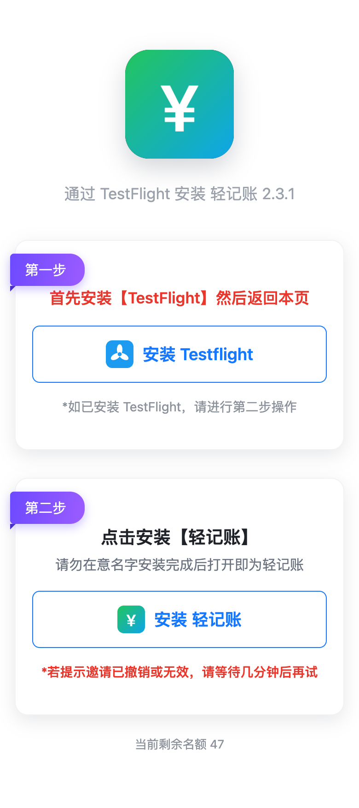
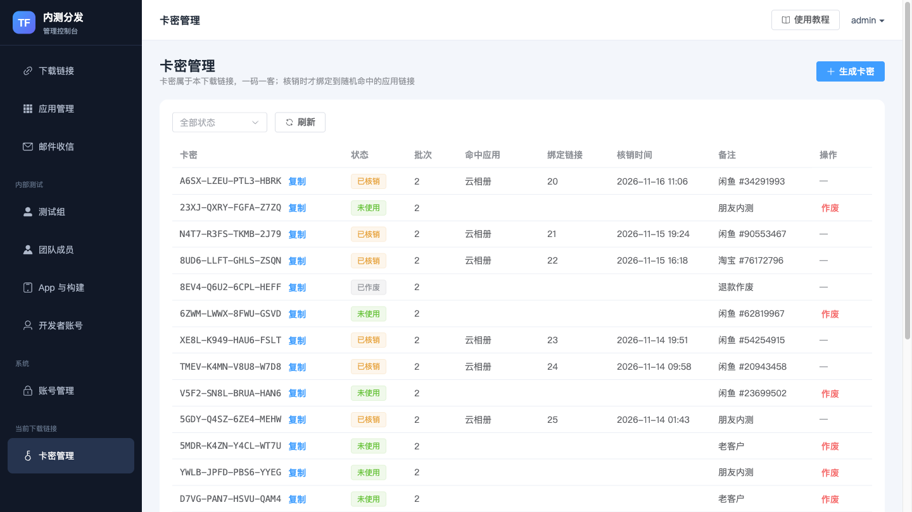

# TestFlight 内测分发管理系统

还在一个个复制 TestFlight 邀请链接发给测试用户？这套系统帮你批量管理邀请链接、自动分配名额、统计发放情况。
提供完整源码，部署在你自己的服务器上。

## TestFlight内部测试和外部测试的主要区别：

| 对比维度 | 内部测试 (Internal Testing) | 外部测试 (External Testing) |
| :--- | :--- | :--- |
| **测试对象** | App Store Connect 团队成员（如管理员、开发者、营销人员） | 团队以外的任意外部用户（如种子用户、客户、普通玩家） |
| **人数上限** | 最多 **100** 人 | 最多 **10,000** 人 |
| **是否需要审核** | **无需审核**，上传处理完成后立即可用 | **需要审核**（Beta App Review），主要版本更新需重新过审 |
| **生效速度** | 极快（通常构建上传后几分钟内） | 较慢（需等待 Apple 审核，通常 1-2 个工作日） |
| **邀请方式** | 在后台将成员加入内部测试群组，发送邮件邀请 | 支持**电子邮件邀请**，或生成**公开邀请链接** |
| **公开链接筛选** | 不支持公开链接 | 支持设置人数上限，并可按设备机型、系统版本筛选测试员 |
| **构建版本有效期** | **90 天**（自上传之日起计算） | **90 天**（自上传之日起计算） |
| **适用场景** | 开发阶段的日常冒烟测试、团队内部功能验收 | 大规模公测、收集真实用户反馈、上线前的压力与兼容性测试 |

本系统就是采用TestFlight内部测试的形式，无需审核，上传到AppStore Connect后台即能下载。

## 界面预览

<table>
  <tr>
    <td align="center" width="35%"><b>客户下载页</b> </td>
    <td align="center"><b>下载链接</b> </td>
  </tr>
  <tr>
    <td align="center"><b>应用管理</b> </td>
    <td align="center"><b>卡密管理</b> </td>
  </tr>
</table>

## 功能

- **下载页**：适配手机的两步引导页，先装 TestFlight，再一键领取安装，显示剩余名额
- **自动分配**：用户点击安装，系统自动抓取一条没用过的链接，不重复发、不超发
- **多应用合并名额**：一个下载入口可绑定多个 App，名额合并使用，用户看不出区别
- **卡密模式**：可选，批量生成卡密，一码一用，支持作废
- **数据统计**：发放量、剩余名额、使用率、近 30 天趋势、访问与领取转化
- **防刷**：访问和领取限流、滑动验证、卡密防暴力枚举
- **后台管理**：应用、下载链接自定义名称和图标，上下架，操作审计日志

## 技术栈

Python + FastAPI、Vue 3、MySQL 8，支持宝塔面板部署，1 核 2G 服务器即可运行。

## 你会拿到

- 完整前后端源码，无加密、可二次开发
- 数据库脚本
- 部署文档

## 使用须知

- 系统只做TF链接的管理和分发，不能代替苹果开发者账号，苹果开发者账号还是需要手动管理，目前算半自动分发。
- 后续开发也能把开发者账号管理加进去，二开支持。
- 请在苹果 TestFlight 规则允许的范围内使用，账号风险由使用者自行承担
- 需自备服务器和域名
- 虚拟商品，发货后不退不换，有疑问请先咨询

## 授权

商业软件，购买后可自用和二次开发，未经作者许可不得转售或公开分发源码。

**购买方式**：https://t.me/testautodown
