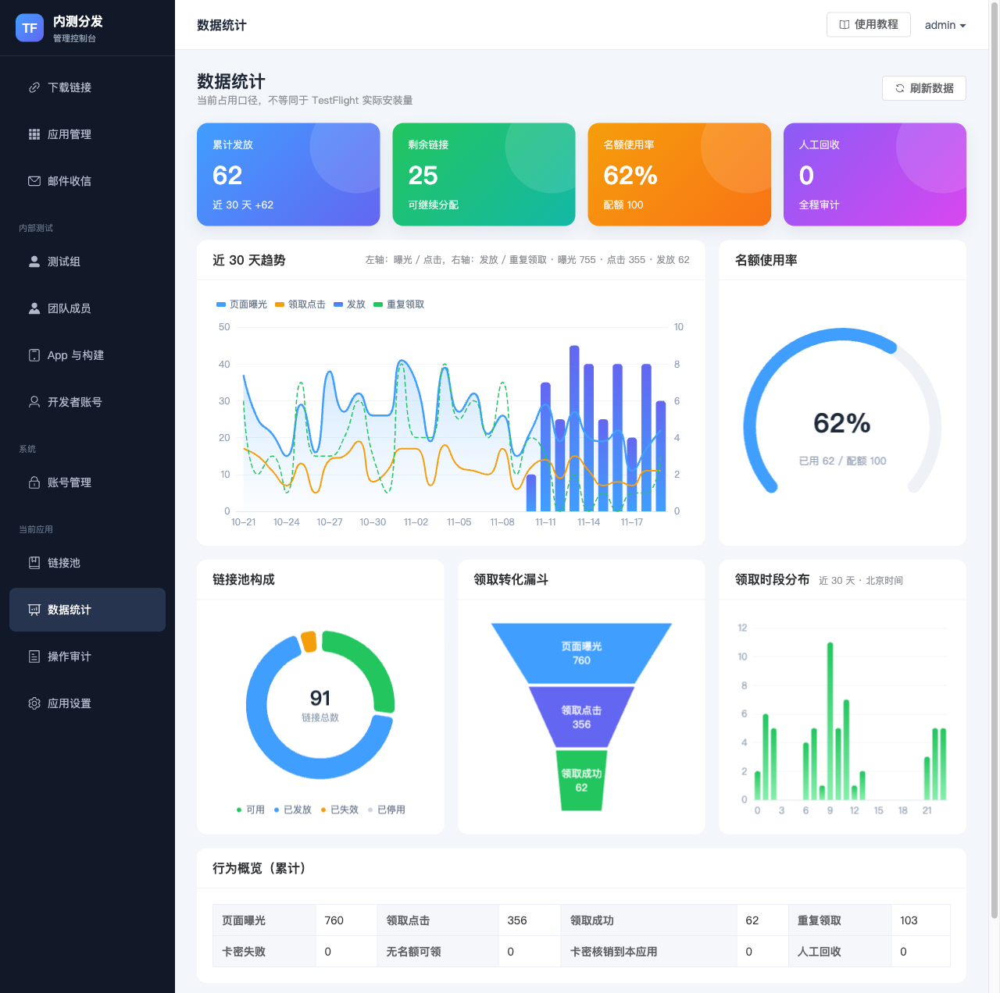
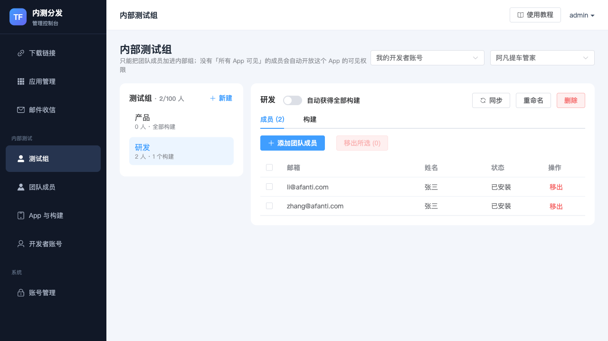
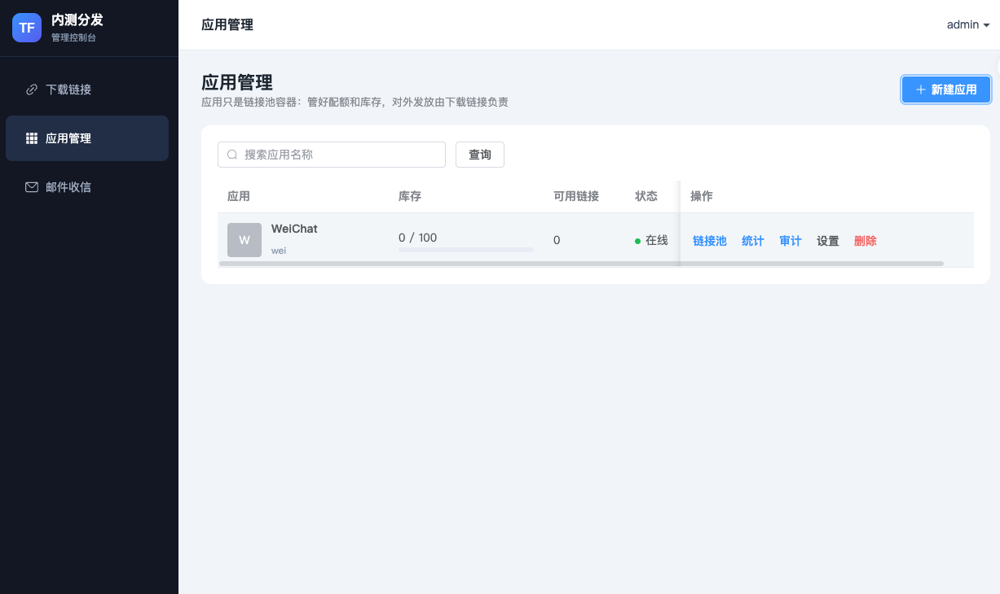

# TestFlight 内测分发管理系统

> 从苹果后台邀请成员、加测试组，到收邀请邮件、给用户发安装链接，全在一个后台里完成。

还在一个个复制 TestFlight 邀请链接发给测试用户？还在苹果后台和邮箱之间来回切换？  
这套系统直接对接 App Store Connect，自动收取邀请邮件、把链接放进链接池，再通过一个下载页发给用户：用户点一下就能装，名额不重复、不超发，后台有完整的数据统计。

提供完整源码，部署在你自己的服务器上，数据都在你自己手里。

## 界面预览

<table>  
  <tr>  
    <td align="center" colspan="2"><b>数据统计</b>  
</td>  
  </tr>  
  <tr>  
    <td align="center" width="35%"><b>客户下载页</b>  
</td>  
    <td align="center"><b>下载链接</b>  
</td>  
  </tr>  
  <tr>  
    <td align="center"><b>内部测试组</b>  
</td>  
    <td align="center"><b>应用管理</b>  
</td>  
  </tr>  
  <tr>  
    <td align="center" colspan="2"><b>卡密管理</b>  
</td>  
  </tr>  
</table>

## 怎么用

```
添加开发者账号 ─→ 邀请团队成员 ─→ 成员加进测试组 ─→ 苹果发出 TestFlight 邀请邮件
                                                              │
用户打开下载页，一键安装 ←─ 下载链接绑定应用 ←─ 自动收信，链接入池 ←─┘
```

后台右上角有「使用教程」，按步骤写清楚了每一步在哪里操作、要注意什么，第一次用也能照着配好。

## 功能

### 用户下载页

- 手机适配的两步引导页：先装 TestFlight，再一键领取安装，可以显示剩余名额
- 自动分配一条没用过的邀请链接，并发领取也不会重复发、不会超发
- 同一个用户再次领取直接打开 TestFlight，不会多占一个名额
- 一个下载入口可以绑定多个 App，名额合并使用，某个 App 发完了自动换下一个，用户察觉不到
- 自定义页面名称、版本号、图标和提示文案，随时上下架
- 可选卡密模式：批量生成卡密，一码一人，支持作废

### 苹果后台对接（App Store Connect API）

- **开发者账号**：支持多个开发者账号，密钥加密存储，一键同步 App、构建、测试组和成员
- **App 与构建**：每个 App 的内部测试员人数（上限 100）、最新构建、构建还剩几天过期，一眼看清
- **内部测试组**：新建、重命名、删除测试组，挑选构建，批量添加或移出成员
- **团队成员**：批量邀请成员进开发者团队（每行「邮箱 姓名」），可随时修改成员能看到哪些 App，支持重新邀请、撤销邀请、移出团队
- 加组时会自动给成员开放该 App 的可见权限，省去来回切换苹果后台

### 数据统计

- 累计发放、剩余链接、名额使用率、人工回收四项核心指标
- 近 30 天趋势：页面曝光、领取点击、发放、重复领取按天展示
- 名额使用率仪表盘、链接池构成、领取转化漏斗、领取时段分布（24 小时）
- 卡密失败、无名额可领等行为数据一并统计

### 后台与安全

- 多管理员账号：新建 / 删除后台账号、重置密码，每个人可以修改自己的密码；改密码后旧的登录状态立刻失效
- 所有关键操作写入审计日志
- 登录会话带 CSRF 校验；公开接口按 IP 限流；领取前要滑动验证；卡密防暴力枚举
- 邮箱授权码、苹果 API 密钥加密存储；生产环境配置不安全时拒绝启动

## 技术栈

- 后端：Python 3.11 + FastAPI + SQLAlchemy
- 前端：Vue 3 + TypeScript + Element Plus + ECharts
- 数据库：MySQL 8
- 部署：宝塔面板，附图文部署指南，1 核 2G 服务器就能跑

## 你会拿到

- 完整前后端源码，没有加密、没有授权校验，可以二次开发
- MySQL 建表脚本和历次升级迁移脚本
- 宝塔部署指南、Nginx 配置、更新与回滚教程
- 单元测试和端到端冒烟脚本

## 使用须知

- 需要你自己有苹果开发者账号；系统帮你管理和分发邀请链接，不能突破苹果的内测人数上限（每个 App 内部测试员最多 100 人）
- 请在苹果 TestFlight 规则允许的范围内使用，账号风险由使用者自行承担
- 需要自备服务器和域名
- 虚拟商品，发货后不退不换，有疑问请先咨询

## 授权

商业软件，购买后可自用和二次开发，未经作者许可不得转售或公开分发源码。

**联系客服购买**：<https://t.me/testautodown>
