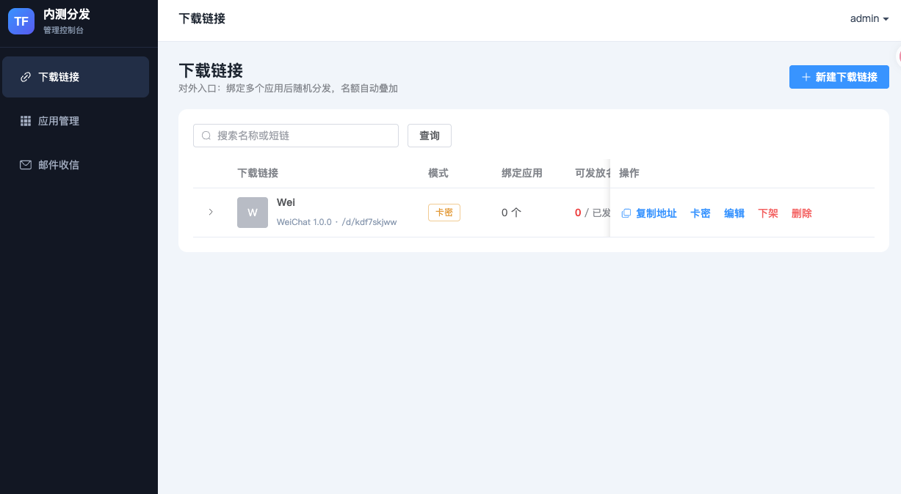

# TestFlight 内测分发管理系统

> 把 TestFlight 邀请链接集中管理，给用户一个下载页，点一下就能装。

还在一个个复制 TestFlight 邀请链接发给测试用户？这套系统帮你批量管理邀请链接、自动分配名额、统计发放情况。
提供完整源码，部署在你自己的服务器上。

## 界面预览

<table>
  <tr>
    <td align="center" width="35%"><b>客户下载页</b> </td>
    <td align="center"><b>下载链接</b> </td>
  </tr>
  <tr>
    <td align="center"><b>应用管理</b> </td>
    <td align="center"><b>卡密管理</b> </td>
  </tr>
</table>

## 功能

- **下载页**：适配手机的两步引导页，先装 TestFlight，再一键领取安装，显示剩余名额
- **自动分配**：用户点击安装，系统自动分配一条没用过的邀请链接，不重复发、不超发
- **多应用合并名额**：一个下载入口可绑定多个 App，名额合并使用，用户看不出区别
- **链接池**：粘贴文本自动提取邀请链接，批量导入、自动去重；已发名额可人工回收
- **邮件收信**：绑定 QQ / 163 / 126 等邮箱，一键拉取 Apple 邀请邮件，链接自动入池
- **卡密模式**：可选，批量生成卡密，一码一用，支持作废
- **数据统计**：发放量、剩余名额、使用率、近 30 天趋势、访问与领取转化
- **防刷**：访问和领取限流、滑动验证、卡密防暴力枚举
- **后台管理**：应用、下载链接自定义名称和图标，上下架，操作审计日志

## 技术栈

Python + FastAPI、Vue 3、MySQL 8，支持宝塔面板部署，1 核 2G 服务器即可运行。

## 你会拿到

- 完整前后端源码，无加密、可二次开发
- 数据库脚本
- 部署文档

## 版本与价格

| 版本 | 内容 | 价格 |
| --- | --- | --- |
| 源码版 | 全套源码、数据库脚本、部署文档 | ¥199 |
| 部署版 | 源码版，另外远程部署到你的服务器，配好域名和 HTTPS | ¥399 |
| 定制 | 改界面、加功能 | 另行报价 |

**购买方式**：<!-- 填写联系方式或购买链接 -->

## 使用须知

- 系统只做邀请链接的管理和分发，不能代替苹果开发者账号，也不能突破苹果的内测人数上限
- 请在苹果 TestFlight 规则允许的范围内使用，账号风险由使用者自行承担
- 需自备服务器和域名
- 虚拟商品，发货后不退不换，有疑问请先咨询

## 授权

商业软件，购买后可自用和二次开发，未经作者许可不得转售或公开分发源码。
